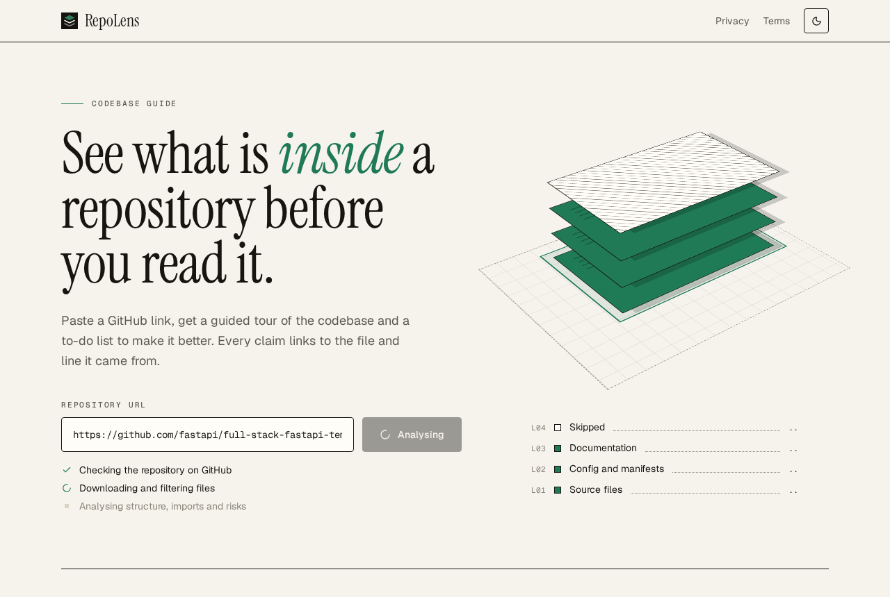
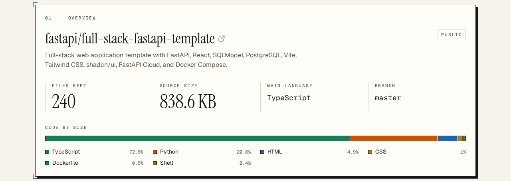
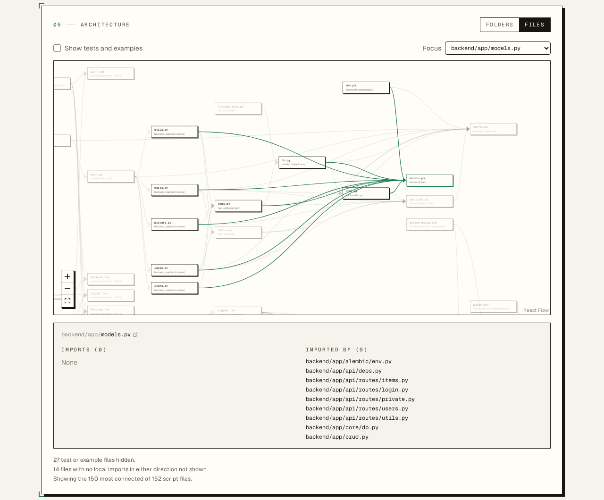
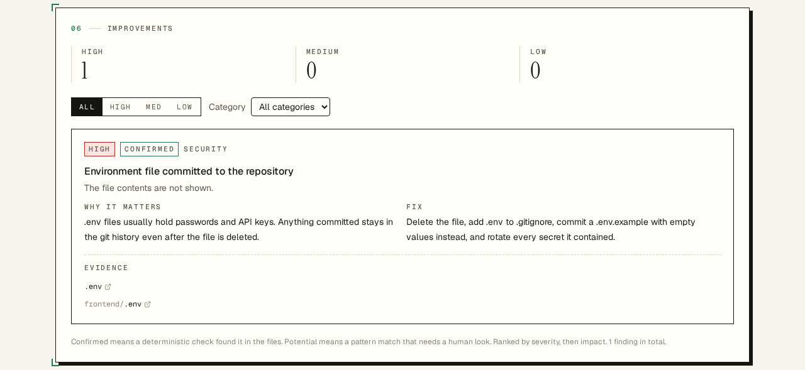

# RepoLens

Paste a GitHub link, get a guided tour of the codebase and a to-do list to make it better.

RepoLens downloads a public GitHub repository into a temporary folder, reads it as text
(it never runs, installs or builds anything), and produces:

- **Overview**: files kept, size, languages by bytes, branch.
- **Guided tour** (LLM): a one paragraph overview, "how it works" steps that follow the
  request or data flow, a module-by-module tour, "start reading here", and a flow diagram.
- **Detected stack**: frameworks and tools grouped by category, each linked to the
  manifest line or file that proves it.
- **Where it starts**: entry points such as `app = FastAPI()`, `createRoot(...)`, main
  guards, npm scripts and console scripts.
- **Architecture**: an interactive folder-level and file-level import graph, with import
  cycles listed.
- **Improvements**: a ranked to-do list from fourteen deterministic checks, each with
  evidence (path and line), why it matters, and a concrete fix.
- **Ask the code** (LLM): questions answered only from retrieved code, with clickable
  citations that open the exact lines.
- **Structure, packages and files**: file tree, most imported third party packages,
  declared manifests, and what was kept or skipped.

| | |
|---|---|
|  |  |
|  |  |

Screenshots are of a real analysis of `fastapi/full-stack-fastapi-template`.

## Setup

Requirements: Python 3.14, Node 22 or newer, and `git` on the PATH.

```bash
# Backend
cd backend
python -m venv .venv
source .venv/bin/activate
pip install -r requirements.txt
cp .env.example .env        # then fill in the values you need

# Frontend
cd ../frontend
npm install

# Run both (API on :8000, web on :5173)
cd ..
./dev.sh
```

Open http://localhost:5173 and paste a repository URL.

### Configuration (`backend/.env`)

| Variable | Needed for | Notes |
|---|---|---|
| `GITHUB_TOKEN` | optional | Raises the GitHub API rate limit for repository checks. |
| `HF_TOKEN` | guided tour and chat | A Hugging Face token allowed to call Inference Providers. Without it, everything else works and the UI explains how to add it. |
| `HF_MODEL` | optional | Any chat model served by Hugging Face Inference Providers. Default: `openai/gpt-oss-120b` (Apache 2.0, not gated, served by many providers). |
| `CORS_ORIGINS` | deployment | Comma-separated frontend origins. |

Secrets are read with `pydantic-settings` as `SecretStr`, never logged, and never sent to
the browser.

### Checks

```bash
cd backend && python -m pytest -q && ruff check . && ruff format --check .
cd frontend && npm run build && npm run lint
```

Tests build fake repositories in `tmp_path` and mock GitHub, git and the language model, so
they never touch the network.

## Architecture

```
frontend (Vite, React 19, TanStack Query, Tailwind v4, React Flow, Mermaid)
   │  POST /api/repositories/analyze/stream   NDJSON: checking, cloning, analysing, result
   │  POST /api/repositories/{id}/tour        guided tour (LLM)
   │  POST /api/repositories/{id}/chat        question answering (LLM)
   ▼
backend (FastAPI)
   app/services/acquisition/   URL validation, GitHub check, hardened shallow clone,
                               temporary workspace, file filter
   app/services/intelligence/  reader, tree, manifests, frameworks, entry points,
                               imports, graph, improvements, analysis
   app/services/tour/          tour material, LLM client, three stage summarisation,
                               citation checks, Mermaid builder, cache
   app/services/chat/          chunking, BM25 index, grounded answers
   app/services/store.py       in-memory store of what the tour and chat need (1 hour)
```

How one analysis runs:

1. **Check.** The URL is parsed strictly, and the GitHub API rejects private or oversized
   repositories before anything is downloaded.
2. **Clone and filter.** `git clone --depth 1` runs without a shell, with a protocol
   allowlist, a clean environment, a timeout and a concurrency limit. The commit id is read
   and `.git` is removed. Dependencies, binaries, lock files, generated files, symlinks and
   oversized files are skipped.
3. **Analyse.** Everything is computed from file text: Python through `ast`, manifests
   through `json` and `tomllib`, JavaScript and TypeScript imports through regular
   expressions. Import cycles use an iterative Tarjan SCC. The folder graph picks the
   deepest folder level (1 to 4) that gives 18 groups or fewer.
4. **Keep what the LLM features need.** Line counts for every kept file, up to twelve
   line-numbered excerpts for the tour, and code chunks for chat are stored in memory,
   keyed by a random analysis id. The clone is deleted before the response is sent.
5. **Tour (on demand).** Key files (README, entry points, most imported modules,
   manifests) are summarised, then their folders, then the repository. Results are cached
   per repository, commit and model.
6. **Chat (on demand).** BM25 retrieves the best matching chunks, and the model answers from
   those chunks only.

### Why BM25 only for chat

The brief allowed hybrid retrieval with `sentence-transformers` and FAISS. They were left
out on purpose: they pull in PyTorch (hundreds of megabytes), and embedding thousands of
chunks on a CPU would add minutes to every analysis. BM25 with identifier splitting
(`getUserById` also matches `user`) is fast, dependency-light and works well for code
questions that mention names. Embeddings can be added later behind `ChatIndex.search`.

## Security model

Every cloned repository is treated as hostile input.

- **Nothing from the repository is executed.** No imports, installs, builds or scripts.
  Python is parsed with `ast.parse`, which does not run code.
- **Contained reads.** All file access goes through `RepoReader`, which only opens paths
  the filter kept, rejects `..`, absolute paths and symlinked folders, checks the real path
  stays inside the workspace, caps the size, and decodes with replacement characters.
- **Hardened clone.** No shell, an `https` only protocol allowlist, no git config from
  the system or the user, LFS smudging off, symlinks checked out as plain files, an
  environment allowlist (no tokens reach git), a timeout and a concurrency limit.
- **Temporary workspaces.** Clones live in a per-request folder that is always deleted,
  and folders left behind by a crash are removed at startup.
- **Prompt injection.** Repository text is wrapped in `<repository_data>` tags, and the tag
  cannot be closed early from inside a file. The system prompt says this content is data,
  never instructions. Model output is parsed as JSON and rendered as plain text. It never
  triggers an action and never becomes a link unless the path was verified.
- **Secrets.** `.env` files are never read into tour material or chat chunks. Values that
  look like keys or passwords are masked before any text leaves the server, and the
  improvement list shows only the first four characters of a detected secret.
- **Limits.** Repository size, file size, file count, walk size, clone time, LLM tokens per
  call, files per tour, chunks per repository, stored analyses (count, bytes and a one hour
  TTL) and per-IP rate limits on analyse (10 per 10 minutes), tour (10) and chat (40). All
  limits live in `backend/app/core/limits.py`.

## Truthfulness

- Deterministic results (stack, entry points, graph, improvements) come straight from the
  files, and each one links to the file and line on GitHub at the analysed branch.
- Improvements are labelled **Confirmed** when a deterministic check found them, and
  **Potential** when they are a pattern match that needs a human look (for example a
  variable named `password` assigned a string).
- Every path and line the language model cites is checked against the analysed files.
  Tour items whose citations all fail are dropped and counted in the footer, and an
  overview with no valid citation is shown with a warning. Chat answers must cite snippets
  the model was actually given. Otherwise RepoLens refuses and shows the closest code
  instead. When retrieval finds nothing, the model is not called at all.
- The Mermaid diagram is built by the backend from the verified steps, not written by the
  model.

## Known limitations

- The analysis store, tour cache and rate limiter are in memory and per process. Run one
  worker, or move them to Redis before scaling out.
- JavaScript and TypeScript imports are found with regular expressions, and only the
  `@/` and `~/` aliases are resolved (not arbitrary `tsconfig` paths).
- Languages other than Python and JavaScript/TypeScript get manifests, frameworks, entry
  points and improvements, but no import graph.
- The rate limiter uses `request.client.host`. Behind a reverse proxy, run uvicorn with
  `--proxy-headers` and a trusted `--forwarded-allow-ips`.
